# Pay-bot

Payme va Click orqali to'lov qabul qiladigan Telegram bot.

Mijoz chatdan chiqmasdan to'laydi, tizim to'lovni o'zi tasdiqlaydi — chek rasmini tekshirish shart emas.

---

**Sahifa:** [abduazizbobomalikovnode.github.io/Pay-bot/](https://abduazizbobomalikovnode.github.io/Pay-bot/)

## Muammo

Kichik biznes Telegram orqali sotadi. Mijoz to'laydi, chek rasmini tashlaydi, sotuvchi uni ochib ko'radi, summani tekshiradi va buyurtmani tasdiqlaydi.

Har buyurtma uchun bir necha daqiqa. Kuniga o'nlab buyurtma bo'lsa — soatlar. Kechqurun esa hech kim javob bermaydi va mijoz ertagacha kutadi.

Bank kabinetiga kirib solishtirish alohida ish, va u ham qo'lda qilinadi.

## Nima qiladi

- **To'lovni chat ichida qabul qiladi** — mijoz summani yozadi, bot [Payme](https://payme.uz) invoysini chiqaradi (Telegram to'lovlari orqali)
- **O'zi tasdiqlaydi** — to'lov o'tgach Telegram botga xabar beradi, chek rasmi kerak emas
- **Kanalga chek yuboradi** — to'lov ID, summa, to'lovchi ismi va telefoni, sana va vaqt admin kanaliga tushadi
- **Joylashuvni ko'rsatadi** — "Joylashuvimiz" tugmasi manzilni xaritada yuboradi

[Click](https://click.uz) uchun sahna ham yozilgan (`room/click.js`), lekin menyudagi tugmasi hozircha o'chirilgan.

## Qanday ishlaydi

<p align="center">
  
</p>

```
Mijoz  ──►  "To'lovlar" → payme tugmasi
              └─► summani yozadi (1000 so'mdan ko'p)
                    └─► bot invoys chiqaradi, mijoz chatda to'laydi
                          ├─► Telegram to'lovni tasdiqlaydi
                          └─► admin kanaliga chek boradi
```

## O'rnatish

```bash
git clone https://github.com/AbduazizBobomalikovNode/Pay-bot.git
cd Pay-bot
npm install

cp .env.example .env      # qiymatlarni to'ldiring
npm start
```

## Environment

| O'zgaruvchi | Nima uchun |
|---|---|
| `BOT_TOKEN` | [@BotFather](https://t.me/BotFather) bergan token |
| `TOKEN_PAYME` | Payme merchant kaliti |
| `TOKEN_CLICK` | Click merchant kaliti |
| `INFO_ADMIN_CHANNEL` | Xabar boradigan kanal ID |

Merchant kalitlari to'lov tizimlarining shaxsiy kabinetidan olinadi.

## Tuzilma

```
index.js           bot, menyu va chek yuborish
room/payme.js      Payme to'lov sahnasi
room/click.js      Click to'lov sahnasi
keyboard/meny.js   menyu tugmalari
images/            rasmlar
docs/              landing sahifa
Procfile           serverga joylash uchun
```

## Texnologiyalar

Node.js · Telegraf · Telegram Bot Payments (Payme, Click)
